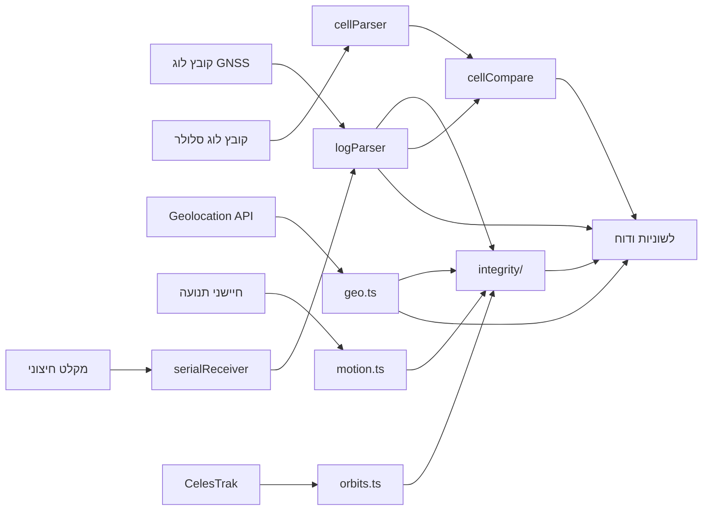

# ארכיטקטורה ומדריך למפתחים

המסמך מסביר איך הקוד בנוי, איך הנתונים זורמים בו, ואיך מוסיפים פיצ'ר, בדיקה או פורמט קובץ בלי לשבור משהו.

## עקרונות שלא משנים בלי החלטה מפורשת

- **אין שרת:**
  - האתר הוא קבצים סטטיים.
  - כל החישובים רצים בדפדפן.
  - שום מידע לא יוצא מהמכשיר בלי פעולה מפורשת של המשתמש.
- **כל קובץ שהמשתמש טוען הוא קלט עוין:**
  - מגבלות גודל ושורה
  - בדיקת טווחים
  - בלי regex שעלול להיתקע
  - חיפוש עמודות דרך `Map`, כדי למנוע prototype pollution
- **CSP קשיח:** ב-[vite.config.ts](vite.config.ts). כל שרת חיצוני חדש דורש שלושה דברים:
  - לעדכן את ה-CSP
  - לעדכן את סעיף הפרטיות ב-README
  - לבקש הסכמה מהמשתמש לפני הפנייה הראשונה
- **בלי תלויות חדשות בזמן ריצה בלי בדיקה.** כל חבילה היא סיכון בשרשרת האספקה. ראו [SECURITY.md](SECURITY.md).

## מפת הקבצים

| שכבה | קבצים | תפקיד |
|---|---|---|
| **קריאת קבצים** | `logParser.ts`, `cellParser.ts`, `logLoader.ts` | לוגים של GNSS (GnssLogger, GPSTest, NMEA) ושל סלולר → מבני נתונים. פונקציות טהורות, בלי React |
| **ניתוח** | `integrity/` (תיקייה), `cellCompare.ts`, `gnssMetrics.ts`, `report.ts` | זיהוי שיבוש וזיוף, השוואת GNSS לסלולר, מדדים משותפים וסטטיסטיקות לדוח. טהורים |
| **מקורות חיים** | `geo.ts`, `motion.ts`, `serialReceiver.ts`, `orbits.ts` | Hooks: מיקום מהדפדפן, חיישני תנועה, מקלט חיצוני, מסלולי לוויינים (SGP4) |
| **לשוניות** | `App.tsx`, `LiveView.tsx`, `LogView.tsx`, `PlotsView.tsx` | `App` מחזיק את המצב המשותף. כל לשונית היא קובץ |
| **רכיבי תצוגה** | `IntegrityPanel`, `LiveSats`, `ReceiverConnect`, `ReportView`, `RecordGuide`, `AppInfo`, `MapView`, `ErrorBoundary` | חלקי ממשק |
| **גרפים** | `LiveCharts`, `SatCharts`, `SkyPlot`, `CellChart`, ו-`Cn0TimeChart` שבתוך `PlotsView` | SVG שנכתב ביד (מפת החום ב-canvas) |
| **משותף** | `format.ts`, `colors.ts`, `timeAxis.ts`, `useWidth.ts`, `forcedWidth.ts`, `device.ts`, `localData.ts`, `skyMath.ts` | פורמט זמנים, פלטת צבעים, ציר זמן, רוחב גרף, זיהוי מכשיר, אחסון מקומי |
| **אבטחה** | `trustedTypes.ts` (נטען ראשון ב-`main.tsx`), ה-CSP ב-`vite.config.ts` | |
| **עיצוב** | `dashboard.css` | קובץ אחד, מחולק לפי אזורים עם כותרות הערה |

## זרימת הנתונים

- **המצב שמשותף ללשוניות** נמצא ב-`App.tsx`, ולכן הוא שורד מעבר בין לשוניות:
  - המעקב החי
  - חיישני התנועה
  - חיבור המקלט
  - הלוג שנטען
  - קובץ הסלולר
- **כל לשונית מקבלת את מה שהיא צריכה כ-props.**

## איך עושים דברים נפוצים

### להוסיף בדיקת שיבוש או זיוף
1. **לבחור משפחה:** לבחור את הקובץ המתאים ב-`src/integrity/`. למשל `receiver.ts` לנתוני לוויינים, או `position.ts` למיקום בלבד.
2. **לכתוב פונקציה** `export function checkX(data, acc: Acc)`:
   - **ממצא:** `acc.findings.push({ id, severity, title, detail, benign, at })`. הראיה המספרית ב-`detail`, וההסבר התמים ב-`benign`. זה חובה.
   - **בדיקה שעברה:** `acc.passed.push('...')`.
   - **בדיקה שלא הייתה אפשרית:** `acc.unavailable.push('...')`.
   - **ציר הזמן:** `bumpT(acc, t, weight)`, כדי שהממצא יופיע בציר זמן החשד.
3. **לקרוא לה מ-`analyzeLog` ו/או `analyzeLive`** ב-`src/integrity/index.ts`.
4. **ספים:** אובייקט עם שם בראש הקובץ (כמו `CLOCK`, `NET`), כל ערך עם הערה שמסבירה מאיפה הוא בא.
5. **בדיקות:**
   - להוסיף התקפה מהונדסת ב-`tests/fixtures/generate.mjs`.
   - להוסיף שורה ל-`ATTACKS` ב-`tests/unit/integrity.test.mjs`.
   - לוודא שהלוגים האמיתיים עדיין יוצאים 0.

### לכייל ספים
- **איפה:** הספים מרוכזים באובייקטים `T`, `NET`, `SKY`, `CORR`, `CLOCK`, `SENSE` (בתיקייה `integrity/`) ו-`CMP` (ב-`cellCompare.ts`).
- **הבדיקה:** `npm test` מריץ את המנוע על הלוגים האמיתיים ועל כל ההתקפות.
- **אם שינוי סף מפיל בדיקה:** זה סימן להחליט במודע, לא לעקוף.

### להוסיף פורמט קובץ
- **GNSS:** הפרסר ב-`logParser.ts` קורא את שורות הכותרת (`# Fix,...`). עמודה חדשה מוסיפים לפי שם.
- **סלולר:** ב-`cellParser.ts` מוסיפים כינויי עמודות ל-`COLS`.
- **בדיקות:** לכל פורמט מוסיפים בדיקה ב-`tests/unit/parsers.test.mjs`, כולל קלט עוין.

### להוסיף רכיב תצוגה או גרף
- **רוחב:** גרף מקבל רוחב מ-`useWidth()`, לא מ-viewBox, כדי שהטקסט יישאר בגודל אמיתי. בהדפסה הרוחב נכפה דרך `ForcedWidth`.
- **צבעים:** מ-`colors.ts`. הצבע של מערכת לוויינים נקבע לפי המערכת, לא לפי הסדר.
- **זמנים:** מ-`format.ts`. מעקב חי מוצג בשעון המקומי, ולוגים ב-UTC.
- **רכיב שעלול להיכשל:** עוטפים ב-`<ErrorBoundary label="...">`.
- **יעד מגע:** לפחות 44 נקודות. בדיקות `devices` אוכפות את זה.

## בדיקות

| פקודה | מה רץ | זמן |
|---|---|---|
| `npm test` | 33 בדיקות יחידה: פרסרים, קלט עוין, מנוע השלמות על 4 לוגים אמיתיים ו-10 התקפות, השוואת סלולר, מדדים | כ-3 שניות |
| `npm run build && npm run test:e2e` | 8 סוויטות דפדפן (281 בדיקות) על גרסת הייצור: Chrome בפרופיל אנדרואיד, WebKit בפרופילי אייפון SE עד 15 Pro Max | כ-5 דקות |
| `npm run test:e2e -- --network` | גם סוויטת `receiver`, שצריכה אינטרנט (מסלולים חיים מ-CelesTrak) | +2 דקות |
| `npm run test:e2e -- --only=plots,report` | רק הסוויטות האלה | |

**מה צריך כדי להריץ את בדיקות הדפדפן:**
- Google Chrome מותקן.
- WebKit של Playwright. מתקינים פעם אחת עם `npx playwright-core install webkit`. ב-Linux צריך להוסיף `--with-deps`.

**קבצי הבדיקה:**
- **לוגים אמיתיים:** ב-`tests/fixtures/` (מקור ורישיון ב-README שם).
- **התקפות וקלט עוין:** נוצרים בכל הרצה על ידי `tests/fixtures/generate.mjs`, תמיד אותם קבצים, ונשמרים ב-`tests/.generated/` (לא בגיט).

**ב-GitHub:**
- `ci.yml` ו-`deploy.yml` מריצים lint, פורמט ובדיקות יחידה. הפרסום נחסם אם משהו נכשל.
- `e2e.yml` מריץ את בדיקות הדפדפן על כל push. הוא עדיין לא חוסם פרסום.

## סגנון

- **פורמט:**
  - Prettier (`npm run format`), ו-`format:check` רץ ב-CI.
  - רוחב שורה: 120 תווים, בלי נקודה-פסיק.
  - מחרוזות עברית ארוכות לא נשברות.
- **TypeScript ו-lint:** TypeScript במצב strict, ו-oxlint (`npm run lint`).
- **הערות:** באנגלית, ומסבירות **למה** ולא רק מה. למשל, למה שדה מחושב ב-BigInt.
- **טקסטים בממשק:** בעברית, כתובים ישירות בקוד. גרסה באנגלית תדרוש להוציא אותם למודול נפרד.
- **שינוי שמשתמשים רואים:**
  - שורה ב-[CHANGELOG.md](CHANGELOG.md)
  - העלאת גרסה ב-`package.json`
  - תגית `vX.Y.Z` אחרי שהפרסום עבר
